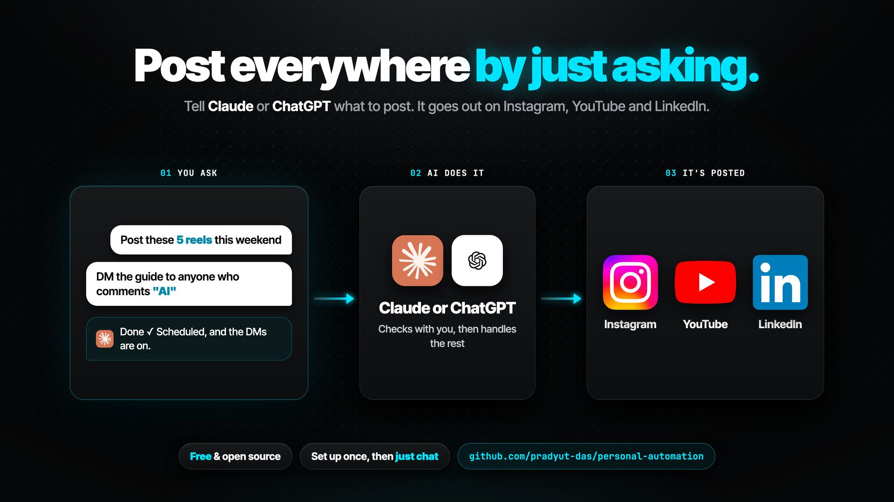

# Personal Automation

**Post everywhere by just asking.** Tell Claude or ChatGPT what to post, and it goes out on Instagram, YouTube and LinkedIn. Free and open source: set it up once, then just chat.

> "Schedule these 5 reels, one at 10am and one at 6pm."
> "If anyone comments AI, DM them the workflow PDF, but only if they follow me."
> "Put the guide link on my YouTube video."
> "Post this carousel on LinkedIn Monday 9am."
> "How did yesterday's reel do, and who asked for the guide?"

You say it in plain language. **Claude Code** (or **ChatGPT's Codex**) reads [`AGENTS.md`](AGENTS.md), runs this repo's `pa.py`, shows you exactly what it's about to post, and reports back. A small Cloudflare Worker does the rest 24/7 on the free tier: publishing, comment → DM flows, follow-ups, link tracking, alerts. No dashboards to click through, no paid DM tools, no laptop left on.



I built this with Claude to run my own accounts and replaced the paid tools I was using. This repo is a minimal, cleaned-up copy you can deploy for yours.

### Use it from a chat
1. Deploy it once (see **Setup** below; you can ask your agent to walk you through it).
2. Open the repo in **Claude Code** (`claude`) or **Codex** (`codex`).
3. Just ask. The agent follows [`AGENTS.md`](AGENTS.md): it confirms captions, times and links with you before anything is published or sent.

---

## What it does

| | Instagram | YouTube | LinkedIn (personal profile) |
|---|---|---|---|
| **Scheduled publishing** | Reels, image posts, carousels, stories, with custom reel covers | Videos + Shorts, using YouTube's own `publishAt` | Text, image(s), video, PDF carousel |
| **Media handling** | Videos checked against Instagram's top spec and re-encoded only when needed (1080×1920, H.264 High, ≤25 Mbps, AAC 48 kHz) | Original file uploaded untouched | PDFs compressed with a visual check |
| **Links** | Comment keyword → public reply → DM with a button → optional follow check → tracked link | Link on the first line of the description | – |
| **Follow-ups** | 1 hour later: "haven't opened it yet?" or "how was it?" with quick replies | – | – |
| **Other triggers** | DM keywords, story replies, story mentions, "any post" keywords | Optional keyword comment replies (quota-aware) | – |
| **Analytics** | Views, reach, likes, saves + your funnel (triggered → DM → link → opened) | Views, likes, comments, watch time | – |

**Across all three:** a content calendar, a read-only team dashboard, email alerts (failed DMs, disconnected accounts, "need help" replies) and a daily summary.

### What the platforms don't allow (so this doesn't either)
- **Instagram:** DMs only within 24 hours of the person's last message; one private reply per comment; ~200 automated DMs/hour. If another tool (ManyChat, SuperProfile, etc.) owns a conversation, you can't reply in it.
- **YouTube:** no DMs; 10,000 API units/day (an upload costs 1,600, a comment reply 50). Uploads from an **unaudited** Google Cloud project stay private until Google approves the project.
- **LinkedIn:** personal-profile apps can post but not read comments or send DMs; sign-ins last 60 days and can't be renewed automatically (you get an email a week before).

---

## How it works

- **One Cloudflare Worker** (`worker/src`) with:
  - an **every-minute cron** that publishes due posts on all three platforms, sends follow-ups, drains the rate-limit queue, retries failed webhooks and checks YouTube comments
  - a **daily cron** for token refresh, cleanup and the summary email, and a **6-hourly** one for analytics
- **Webhooks** from Meta are signature-checked, **saved to the database before they're processed**, de-duplicated, and retried with backoff (1, 5, 15, 60 min).
- **D1** (SQLite) holds accounts, automations, leads, posts and events. **R2** holds uploaded videos, covers and PDFs. PDFs are served as a mobile flipbook.
- **`pa.py`** is the command line your AI agent runs for you (you can run it yourself too). It uploads files straight to R2 (so large videos skip the Worker's 100 MB request limit) and calls the Worker's admin API.

```
AGENTS.md             how Claude Code / Codex should operate this from a chat
worker/
  src/index.js        router, admin API, legal pages, crons
  src/webhooks.js     durable webhook store + retries
  src/automation.js   Instagram comment/DM/story flows, follow-ups, click tracking
  src/sender.js       rate-limited sending + queue
  src/scheduler.js    Instagram publishing state machine
  src/youtube.js      YouTube connect, uploads, comment replies, stats, quota
  src/linkedin.js     LinkedIn connect, uploads, posts
  src/stats.js        Instagram analytics
  src/calendar.js     cross-platform calendar
  src/dashboard.js    read-only dashboard
  src/alerts.js       Resend email alerts + daily summary
  src/media.js        R2 file serving + PDF flipbook
  migrations/         D1 schema (run in order)
pa.py                 CLI
```

---

## Setup

### 0. What you need
- A free **Cloudflare** account, plus **Node 20+** (for `npx wrangler`).
- **Python 3.10+**, **ffmpeg** (video checks), and optionally **Ghostscript** (PDF compression): `brew install ffmpeg ghostscript`.
- Accounts on whichever platforms you want: an Instagram **professional** account, a YouTube channel, a LinkedIn profile.

### 1. Deploy the Worker
```bash
git clone https://github.com/pradyut-das/personal-automation.git
cd personal-automation/worker
npx wrangler login
npx wrangler d1 create personal-automation          # copy the database_id it prints
npx wrangler r2 bucket create personal-automation-media
cp wrangler.toml.example wrangler.toml               # fill in database_id, PUBLIC_URL, OWNER_*, TZ
for f in migrations/*.sql; do npx wrangler d1 execute personal-automation --remote --file=$f; done
npx wrangler deploy                                  # prints your URL: https://personal-automation.<you>.workers.dev
```
Then set the required secrets (`openssl rand -hex 24` makes good random values):
```bash
npx wrangler secret put ADMIN_KEY        # your CLI password
npx wrangler secret put VIEW_PASSWORD    # dashboard password
npx wrangler secret put VERIFY_TOKEN     # any random string, used once by Meta
npx wrangler secret put IG_APP_SECRET    # from step 2
```
Free plan note: Cloudflare allows 5 cron triggers per account, and this uses 3.

### 2. Instagram (Meta app)
1. Go to **developers.facebook.com → My Apps → Create app** and pick the **Instagram** use case. Open **API setup with Instagram login**.
2. Copy the **Instagram app ID** into `IG_APP_ID` in `wrangler.toml`, and the **Instagram app secret** into the `IG_APP_SECRET` secret.
3. Under **Business login settings → OAuth redirect URIs**, add `https://<your-worker>/oauth/callback`.
4. Under **Configure webhooks**, set the callback URL to `https://<your-worker>/webhook` with your `VERIFY_TOKEN`, then subscribe to **comments, messages, messaging_postbacks, standby**.
5. Under **App settings → Basic**, set the privacy policy URL to `https://<your-worker>/privacy` and the data-deletion URL to `https://<your-worker>/data-deletion`. Then **Publish** the app. Meta only sends real webhooks to published apps. App Review isn't required when you only use your own accounts.
6. In the Instagram app: **Settings → Messages and story replies → Message controls → Connected tools → Allow access to messages**.
7. Connect the account: `./pa.py connect` → open the link. If you're testing in Development mode, add test accounts under **App roles → Instagram Testers**.

> If you've used another DM tool on this account, remove it everywhere it's connected: Instagram's *Apps and websites*, Facebook *Business integrations*, and inside the tool itself. Otherwise it keeps "owning" conversations and your replies are refused with `not the thread owner`.

### 3. YouTube (optional)
1. In **console.cloud.google.com**, create a project and enable the **YouTube Data API v3** and the **YouTube Analytics API**.
2. Set up the **OAuth consent screen** as External, then click **Publish app**. In Testing mode, sign-ins expire every 7 days.
3. Create a **Web application** OAuth client with redirect URI `https://<your-worker>/yt/oauth/callback`.
4. `npx wrangler secret put YT_CLIENT_ID` and `npx wrangler secret put YT_CLIENT_SECRET`, then `./pa.py yt-connect`.
5. For public uploads and more quota, submit Google's **YouTube API Services Audit and Quota Extension** form.

### 4. LinkedIn (optional)
1. In **linkedin.com/developers/apps**, click **Create app**. LinkedIn needs a company page to link the app to; posts still go to your personal profile.
2. Under **Products**, request **Sign In with LinkedIn using OpenID Connect** and **Share on LinkedIn**. Both are approved instantly.
3. Under **Auth**, add the redirect URL `https://<your-worker>/li/oauth/callback`.
4. `npx wrangler secret put LI_CLIENT_ID` and `LI_CLIENT_SECRET`, then `./pa.py li-connect`. Reconnect every 60 days.

### 5. Email alerts (optional)
Create a **Resend** API key and verify a sending domain, then set `RESEND_API_KEY`, `ALERT_EMAIL` (where alerts go) and `ALERT_FROM` (e.g. `Automation <alerts@yourdomain.com>`). Test with `./pa.py alert-test`.

### 6. The CLI
```bash
cp .env.example .env     # PA_WORKER, PA_ADMIN_KEY (= ADMIN_KEY), PA_TZ
chmod +x pa.py && ./pa.py --help
```

---

## Usage

The easiest way is to ask your agent ("schedule this reel tomorrow 6pm with a GUIDE automation"). These are the commands it runs:

```bash
# Instagram: schedule a reel with a comment → DM automation that goes live when it publishes
./pa.py post-add --at "2026-12-01 18:30" --type reel --media ./reel.mp4 --cover ./cover.jpg \
  --caption "Comment GUIDE and I'll DM it to you" --keyword guide --thing guide --link ./guide.pdf --follow

# add an automation to a post that's already live (or --post any for every post)
./pa.py auto-add --post https://www.instagram.com/reel/XXXX/ --keyword ai --thing workflow --link https://...

# story triggers
./pa.py auto-add --on story_mention --thing "free guide" --link ./guide.pdf

# YouTube: scheduled upload with the link in the description
./pa.py yt-post-add --at "2026-12-02 17:00" --media ./short.mp4 --title "..." --description-file desc.txt --link ./guide.pdf

# LinkedIn: PDF carousel
./pa.py li-post-add --at "2026-12-03 09:00" --text-file post.txt --media ./carousel.pdf

# see what's going on
./pa.py calendar      ./pa.py stats      ./pa.py leads      ./pa.py log      ./pa.py events
```
The dashboard is at `https://<your-worker>/`: sign in with any username and your `VIEW_PASSWORD`.

---

## Security
- Every secret lives in Cloudflare secrets, and `.env` / `wrangler.toml` are git-ignored.
- Meta webhooks are verified with HMAC-SHA256 before anything is stored. The admin API needs `ADMIN_KEY`; the dashboard needs `VIEW_PASSWORD`.
- Only use this on accounts you own, and follow each platform's automation rules.

## License
MIT
